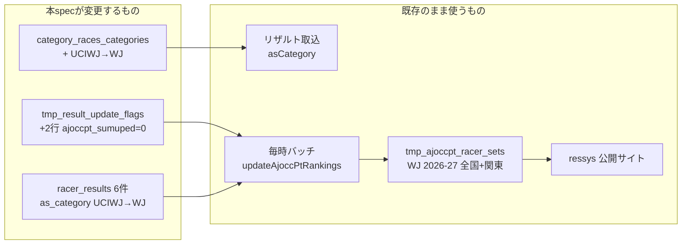
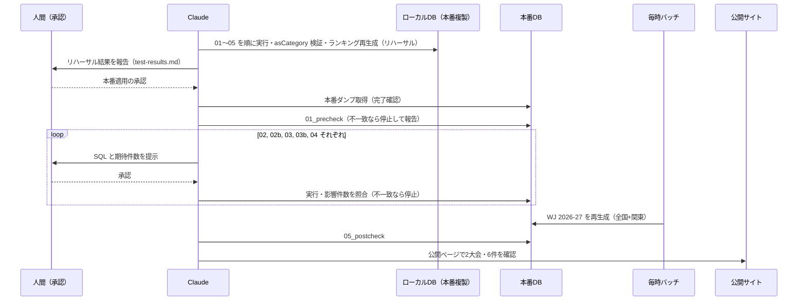

# Design Document: uciwj-wj-ranking-fix-2026-11

## Overview

**Purpose**: UCI-Women Junior 種目（`UCIWJ`）の成績を WJ の成績として扱うようにし、2026-27 シーズンで WJ ランキングから漏れている6件を是正する。
**Users**: AJOCC ランキング（WJ）を見る選手・関係者、ポイント管理を行う運営。
**Impact**: 種目↔カテゴリー対応表に1行（`UCIWJ → WJ`）を加え、種目 UCIWJ の更新日時を進めてデスクトップアプリに配信し、2026-27 の6件と 2023-24 の2件の成績対象カテゴリーを `UCIWJ` から `WJ` に更新する。2026-27 WJ ランキング（全国版・関東地域版）だけを既存バッチで作り直す。アプリケーションのコードは変更しない。

### Goals
- 今後取り込まれる UCIWJ 種目の成績が自動で WJ として記録される（要件1）
- 松伏・琵琶湖の6件が 2026-27 WJ ランキングに計上され、公開サイトに表示される（要件2）
- すべての本番変更を、ローカルでのリハーサル・事前ダンプ・1操作ごとの承認・件数照合の下で行う（要件3）
- 原因と再発防止策を steering に残す（要件4）
- 公開サイトのレース結果表示とデスクトップアプリへの波及を一貫させる（要件5）

### Non-Goals
- アプリケーションコード（cyclox2web）の変更、取込時警告やバッチ通知の追加
- 過去シーズンのランキングの作り直し（2023-24 は成績対象カテゴリーのみ是正）、2016-17 UCX-167-002 の是正
- 他の未対応 UCI 種目（UCIMU / UCIWM / UCIMM / UCIWY / UCIMY）の対応追加
- 公開サイト（ressys）側の仕組みの変更

## Boundary Commitments

### This Spec Owns
- 本番 `category_races_categories` への `UCIWJ → WJ` 1行の追加
- 本番 `racer_results` の6件（id 359429, 359430, 360444, 360445, 360446, 360447）と2件（id 277933, 277934）の `as_category` 列の更新
- 本番 `races_categories` の UCIWJ 行の `modified` の更新（デスクトップアプリへの配信のため）
- 本番 `tmp_result_update_flags` への再生成用フラグ2行の追加
- 上記の事前確認・事後確認・ロールバック用 SQL と手順書、ローカル検証用の使い捨てシェル
- steering への根本原因・再発防止策の記録

### Out of Boundary
- 上記8件の `as_category` 以外の列（ajocc_pt, rank, status, lap, goal_time, rank_per, run_per 等）と、8件以外のリザルト
- 2023-24 以前のランキング（`tmp_ajoccpt_racer_sets`）。2023-24 の2件の出走カテゴリーにはフラグを立てない
- 公開サイト（ressys）とデスクトップアプリ（cyclox2app）のコード。両者は対応表を読んで振る舞いを変えるが、本specはその既存の振る舞いに乗るだけ
- ランキング生成ロジック・取込ロジック・ポイント計算ロジック（既存のまま使う）
- `tmp_ajoccpt_racer_sets` への直接書き込み（既存バッチにのみ書かせる）
- ressys の DB・アプリ
- 本番での cake コマンドの手動実行（バッチ遅延時の手動実行は別途承認事項）

### Allowed Dependencies
- 既存のランキング更新バッチ（`ResultShell::updateAjoccPtRankings`、本番で毎時実行）
- 既存の判定メソッド `ResultParamCalcComponent::asCategory()`（ローカル検証で呼ぶだけ）
- prod-access スキルの接続（`cyclox2-prod` / `ressys-prod`）とダンプ手順
- ローカル docker の `cyclox2_mysql`（本番 20261124 ダンプ反映済み）と `kyamady/img_cyclox2_svr` イメージ

### Revalidation Triggers
- 是正実施までに対象6件のいずれかが再取込・削除され、id や値が変わった場合（事前チェックで検出 → 停止）
- 対応表に UCIWJ の行が既に入っていた場合（誰かが先に追加した）
- ランキング更新バッチの対象条件・実行周期が変わった場合
- 2026-27 の地域版設定（`ajoccpt_local_settings`）が変わった場合（期待値の見直しが要る）
- 対応表を読む処理（公開サイトのレース結果ページ、デスクトップアプリのエントリー検証・新規選手へのカテゴリー付与、管理システムの JCX 系統ロック・系統連動・CSV 集計）が変わった場合

## Architecture

### Existing Architecture Analysis
- 成績対象カテゴリーはリザルト取込時（管理画面アップロード `ResultReadComponent` と、アプリAPI `ApiController` の両経路）に `ResultParamCalcComponent::asCategory()` で1回だけ決まる。種目に紐づくカテゴリーが1件ならそれ、0件なら種目コードがそのまま入る。
- AJOCC ランキングは、更新フラグの立った出走カテゴリーの as_category ごとに、シーズン単位で全国版＋全地域版を作り直す。Category に存在しない as_category はスキップされ、集計では as_category がカテゴリーコードと一致する成績だけが数えられる。
- `calcAjoccPt()` は as_category を参照しない。ポイント値は as_category の変更で変わらない（要件1.3, 2.4）。
- `CatRacerCleanupJudge` は as_category で elite/masters を判定するが、`UCIWJ` も `WJ` も「判定不能」で挙動は同じ。
- 対応表 `category_races_categories` を読む他の処理（Tier 2 レビューで洗い出し）:
  - **公開サイト（ressys）のレース結果ページ**: 種目に対応カテゴリーがあれば AJOCC pt 列を表示し、`ajocc_pt/as_category` を出す（`cyclox2res_sys/application/controllers/Race.php`）。対応追加で全 UCIWJ レースに列が出る。2023-24 の2件を WJ に直すのはこの表示を揃えるため（要件5.1, 5.4）。
  - **デスクトップアプリ（cyclox2app）**: 基本データ同期（`ApiController` updated_base_data）で種目ごとの対応カテゴリー一覧を受け取り、エントリー時の所属チェック（WJ 非保有はエラー表示）と新規選手への WJ 付与に使う。UCIMJ→CJ と同じ振る舞い。同期は「いずれかの種目の modified が前回同期より新しい」ときだけ全種目を返すため、UCIWJ の modified を進めて配信する（要件5.5, 5.6）。
  - **管理システム内**: JcxLineageLock・CategoryLineageLinker は WJ を系統管理の対象外として扱い挙動は変わらない。OrgUtilController の CSV 集計は UCIWJ を集計対象に加える（目的どおり）。
- 2023-24 の2名は大会日に WJ を保有していない（CL1 のみ）。WJ ランキングは当該シーズンに WJ を保有する選手しか載せないため、仮に 2023-24 WJ ランキングが作り直されても2名は載らず、JPN-234-002 の空の大会列が増えるだけ（既知事項）。
- ポイントシリーズの翌日更新モードは `points_sumuped` を見ずに前日の `result_updated` を拾うため、04 のフラグで 28856・29071 を含むシリーズが翌日に再計算される。as_category に依存しないので結果は変わらない。

### Architecture Pattern & Boundary Map



- **Selected pattern**: データ是正のみ（マスタ追加＋列単位の直接更新＋既存バッチによる再生成）。選択肢の比較は `research.md` の Architecture Pattern Evaluation を参照。
- **Steering compliance**: 既存不整合への不介入方針（`existing-data-inconsistency-policy.md`）に沿い、6件以外・as_category 以外には触れない。

### Technology Stack

| Layer | Choice / Version | Role in Feature | Notes |
|---|---|---|---|
| Data / Storage | MySQL 5.7（本番 5.7.23、ローカル docker） | マスタ追加・as_category 更新・フラグ投入 | 本番は `ssh cyclox2-prod 'mysql cyclox2'`（login-path） |
| Backend / Batch | CakePHP 2 シェル（既存） | ランキング再生成 | 本番は既存の毎時バッチ、ローカルは使い捨てコンテナで手動実行 |
| Infrastructure / Runtime | docker イメージ `kyamady/img_cyclox2_svr` | ローカル検証用の使い捨てコンテナ | `--memory=1g`、worktree の submodule をマウント |

## File Structure Plan

### Directory Structure
```
.kiro/specs/uciwj-wj-ranking-fix-2026-11/
├── runbook.md                     # ローカルリハーサルと本番適用の手順（承認ポイント・期待件数・停止条件）
├── sql/
│   ├── 01_precheck.sql            # 事前確認（SELECT のみ）: 対応行0、8件の値、種目 UCIWJ の modified、非カテゴリー件数、DB 時刻・版
│   ├── 02_add_mapping.sql         # 対応表に UCIWJ→WJ を1行追加（期待1）
│   ├── 02b_touch_races_category.sql  # 種目 UCIWJ の modified を現在時刻に（デスクトップアプリへ配信。期待1）
│   ├── 03_fix_as_category.sql     # 2026-27 の6件を UCIWJ→WJ（期待6）
│   ├── 03b_fix_as_category_2324.sql  # 2023-24 の2件を UCIWJ→WJ（期待2。フラグは立てない）
│   ├── 04_enqueue_ranking.sql     # 2026-27 の再生成用フラグ2行を追加（期待2）
│   ├── 05_postcheck.sql           # 事後確認（SELECT のみ）
│   ├── 10_snapshot_racer_results.sql  # 前後比較用（SELECT のみ）
│   ├── 99a_remove_mapping.sql     # 取り消し: 対応行の物理削除＋種目 UCIWJ の modified 更新（期待1・1）
│   ├── 99b_revert_2627.sql        # 取り消し: 6件を UCIWJ に戻す（期待6）
│   ├── 99c_revert_2324.sql        # 取り消し: 2件を UCIWJ に戻す（期待2）
│   └── 99d_enqueue_wj_regen.sql   # 取り消し: WJ を持つ別の 2026-27 出走カテゴリーにフラグ（期待1）
├── tools/
│   ├── AsCategoryCheckShell.php   # ローカル検証専用 CakePHP シェル。asCategory() の判定結果を出力する（cyclox2web にはコミットしない）
│   ├── run_local_cake.sh          # 使い捨てコンテナで worktree の cyclox2web を動かす（ローカル DB 向け）。空のマウント先を後片付けする
│   ├── email_local_debug.php      # ローカル実行時のメール設定（Debug トランスポート。失敗通知メールを実送信しない）
│   └── compare_snapshots.py       # 10_snapshot の前後 TSV を比較し、6件は as_category/modified 以外不変・他行は差分なしを判定
├── test-results.md                # 実行結果の記録（ルール6）
└── integration-test-checklist.md  # 結合試験項目（ルール7）
```

### Modified Files
- `.kiro/steering/db-category-entry-glossary.md` — 「既知の落とし穴」に、対応未登録の種目では成績対象カテゴリーが種目コードのまま記録されランキングから漏れること、AJOCC ポイント付与ありで UCI 種目を使う前の確認手順（検出 SQL）、未対応の UCI 種目一覧と是正しなかった過去シーズンの漏れを追記（要件4）
- `.kiro/specs/uciwj-wj-ranking-fix-2026-11/agreement-log.md` — 各ゲートの合意記録

アプリケーションコード（`cyclox2_svr/cyclox2`）とsubmoduleのポインタは変更しない。

## System Flows



- 承認は 02・02b・03・03b・04 の各操作ごとに取る（要件3.2）。01・05・10 は SELECT のみで承認不要。取り消しも 99a〜99d を1操作ずつ承認・件数照合する。途中で止まった場合は、実行済みの手順に対応する取り消しだけを行う（02→99a、03→99b、03b→99c、03 を戻したら 99d）。
- バッチ反映待ちは最大2時間。過ぎても反映されなければ停止して報告する（手動実行は別途承認）。

## Requirements Traceability

| Requirement | Summary | Components | Flows |
|---|---|---|---|
| 1.1 | UCIWJ 取込で WJ を記録 | 02_add_mapping.sql、AsCategoryCheckShell（6名＋WJ非保有の選手で WJ になることを確認） | ローカルリハーサル |
| 1.2 | WJ ランキングの集計対象になる | 02 → 既存バッチ、05_postcheck | リハーサル・本番 |
| 1.3 | ポイント値を変えない | 設計判断（calcAjoccPt は as_category 非参照）、10_snapshot で ajocc_pt の前後一致を確認 | リハーサル |
| 1.4 | 既存 UCI 種目の扱いを変えない | 02 は1行追加のみ。AsCategoryCheckShell で UCIME/UCIME+U/UCIWE/UCIMJ の判定が前後で同じことを確認 | リハーサル |
| 1.5 | UCIWJ 以外の種目の決まり方を変えない | 02 は races_category_code='UCIWJ' の行のみ。AsCategoryCheckShell で WJ・CL1 等の代表種目が前後で同じことを確認 | リハーサル |
| 2.1 | 6件を WJ に | 03_fix_as_category.sql | リハーサル・本番 |
| 2.2 | 全国版 WJ に2大会と6件 | 04_enqueue_ranking.sql → 既存バッチ、05_postcheck | リハーサル・本番 |
| 2.3 | 地域版にも反映 | 既存バッチが全地域版を再生成。05_postcheck で関東（設定26）に松伏が載ることを確認 | リハーサル・本番 |
| 2.4 | 6件の他項目を変えない | 03 は as_category 列のみ SET。10_snapshot で6件の他列が前後一致 | リハーサル・本番 |
| 2.5 | 8件以外を変えない | 03/03b の WHERE（id・ecat・現在値の3条件）、10_snapshot＋compare_snapshots.py で8件以外の差分なし | リハーサル・本番 |
| 2.6 | 件数・内容が違えば停止 | 01_precheck（8件の値・非カテゴリー件数まで総合判定に含める）、runbook の停止条件 | 本番 |
| 2.7 | 非カテゴリーの as_category が0件 | 05_postcheck | リハーサル・本番 |
| 2.8 | 公開サイトで確認 | runbook の確認手順（data.cyclocross.jp の WJ ランキングページ） | 本番 |
| 3.1 | 事前ダンプ | runbook（prod-access のダンプ手順、末尾 `Dump completed` 確認） | 本番 |
| 3.2 | 1操作ごとの承認 | runbook の承認ポイント（02・02b・03・03b・04、取り消しは 99a〜99d を個別に） | 本番 |
| 3.3 | 影響件数の照合 | 各 SQL の期待件数（02:1, 02b:1, 03:6, 03b:2, 04:2）と実行時の affected rows の照合、不一致時は停止 | 本番 |
| 3.4 | ローカルで先に確認 | runbook のリハーサル章、test-results.md | ローカル |
| 4.1 | 根本原因を記録 | `db-category-entry-glossary.md` 追記 | — |
| 4.2 | 再発防止策と検出手順 | 同上（検出 SQL を含める） | — |
| 4.3 | 既知事項 | 同上（未対応 UCI 種目、過去シーズン、公開サイト・アプリへの波及） | — |
| 5.1 | 2023-24 の2件を WJ に | 03b_fix_as_category_2324.sql | リハーサル・本番 |
| 5.2 | 2件の他項目を変えない | 03b は as_category 列のみ SET、compare_snapshots.py | リハーサル・本番 |
| 5.3 | 2023-24 ランキングを作り直さない | 04 は 2026-27 の ecat だけにフラグ。05_postcheck で season 14 WJ ランキングの modified が適用前のまま | リハーサル・本番 |
| 5.4 | 公開サイトで「pt/WJ」表示 | runbook の確認手順（MDX/KNS/JPN-234-002 のレース結果ページ） | 本番 |
| 5.5 | アプリが対応を受け取れる | 02b_touch_races_category.sql、05_postcheck（UCIWJ の modified が適用時刻以降） | リハーサル・本番 |
| 5.6 | 取り消し時もアプリに届く | 99a（対応行削除と同時に modified を更新） | リハーサル |

## Components and Interfaces

| Component | 種別 | 責務 | 要件 |
|---|---|---|---|
| 01_precheck.sql | SQL（SELECT） | 対応表に UCIWJ 行が無いこと、6件の (id, ecat, racer_code, rank, ajocc_pt, as_category) が期待値どおりであること、2026-27 の UCI 種目の非カテゴリー件数（期待 6）を出力 | 2.6 |
| 02_add_mapping.sql | SQL（INSERT） | `category_races_categories (category_code, races_category_code, created, modified, deleted) VALUES ('WJ','UCIWJ',NOW(),NOW(),0)`。期待 1行 | 1.1, 1.4, 1.5 |
| 02b_touch_races_category.sql | SQL（UPDATE） | `UPDATE races_categories SET modified=NOW() WHERE code='UCIWJ' AND deleted=0`。期待 1行。アプリの基本データ同期が全種目の対応一覧を再送する契機 | 5.5 |
| 03_fix_as_category.sql | SQL（UPDATE） | `UPDATE racer_results SET as_category='WJ', modified=NOW() WHERE id IN (6件) AND as_category='UCIWJ' AND deleted=0` かつ entry_racer 経由で ecat が 28856/29071 のもの。期待 6行 | 2.1, 2.4, 2.5 |
| 03b_fix_as_category_2324.sql | SQL（UPDATE） | 03 と同じ形で id 277933, 277934（ecat 19879）を UCIWJ→WJ。期待 2行。フラグは立てない | 5.1, 5.2, 5.3 |
| 04_enqueue_ranking.sql | SQL（INSERT） | `tmp_result_update_flags` に ecat 28856・29071 の2行（`result_updated=NOW(), points_sumuped=1, ajoccpt_sumuped=0`）。期待 2行 | 2.2, 2.3 |
| 05_postcheck.sql | SQL（SELECT） | 8件の as_category、種目 UCIWJ の modified（今日以降）、2023-24 WJ ランキングの最終更新（適用前のまま）、2026-27 UCI 種目の非カテゴリー件数（期待 0）、`tmp_ajoccpt_racer_sets` の WJ 2026-27 全国版の大会列に MDX-267-002・KNS-267-013 があり各選手の point_json に該当ポイントがあること、関東（設定26）に MDX-267-002 があること、フラグ2行が処理済みであること | 1.2, 2.2, 2.3, 2.7 |
| 10_snapshot_racer_results.sql | SQL（SELECT） | 6件の全列と、6件以外の `racer_results` の件数・as_category 指紋（例: `BIT_XOR(CRC32(CONCAT_WS('|', id, as_category)))`）を出力。前後比較用 | 1.3, 2.4, 2.5 |
| 99a_remove_mapping.sql | SQL | 対応行を物理削除（期待1。論理削除では関連取得が拾い続けるため）し、種目 UCIWJ の modified を更新（期待1。アプリへ削除を配信） | 3, 5.6 |
| 99b_revert_2627.sql | SQL | 6件を UCIWJ に戻す（期待6） | 3 |
| 99c_revert_2324.sql | SQL | 2件を UCIWJ に戻す（期待2） | 3 |
| 99d_enqueue_wj_regen.sql | SQL | 2026-27 で WJ の成績を持つ別の AJOCC 対象出走カテゴリーにフラグ1行（是正対象に立てると UCIWJ がスキップされ WJ ランキングが戻らない。リハーサルで判明）。期待1 | 3 |
| compare_snapshots.py | スクリプト | 前後 TSV を比較。8件は UCIWJ→WJ かつ as_category/modified 以外不変、他行は差分なし | 1.3, 2.4, 2.5, 5.2 |
| AsCategoryCheckShell.php | CakePHP シェル（ローカル専用） | 指定の (racer_code, races_category_code, at_date) について `ResultParamCalcComponent::asCategory()` の戻り値を表形式で出力する。DB を書き換えない | 1.1, 1.4, 1.5 |
| runbook.md | 手順書 | リハーサル手順、本番手順、承認ポイント、期待件数、停止条件、バッチ待ち時間、ロールバック手順 | 2.6, 2.8, 3.1〜3.4 |

### AsCategoryCheckShell の検証ケース
| ケース | 入力（選手 / 種目 / 日付） | 追加前の期待 | 追加後の期待 |
|---|---|---|---|
| 6名（2大会分） | 各選手 / UCIWJ / 大会日 | UCIWJ | WJ |
| WJ を保有しない選手（例: 新規・未登録扱い racer_code 空） | 空 / UCIWJ / 2026-11-22 | UCIWJ | WJ |
| 既存 UCI 種目 | C1 保有選手 / UCIME, UCIME+U、CL1 保有選手 / UCIWE、CJ 保有選手 / UCIMJ | C1, C1, CL1, CJ | 同じ |
| 他の種目 | WJ 保有選手 / WJ、CL1 保有選手 / CL1 | WJ, CL1 | 同じ |

## Data Models
スキーマ変更なし。変更するのは次の値のみ。

| テーブル | 変更 | 件数 |
|---|---|---|
| `category_races_categories` | 行追加 `(category_code='WJ', races_category_code='UCIWJ', deleted=0)` | 1 |
| `racer_results` | `as_category`: `UCIWJ` → `WJ`（＋`modified`） | 6＋2 |
| `races_categories` | UCIWJ 行の `modified` を現在時刻に | 1 |
| `tmp_result_update_flags` | 行追加（ecat 28856, 29071） | 2 |
| `tmp_ajoccpt_racer_sets` | 既存バッチが WJ×2026-27 の全国版・地域版を作り直す（本specは直接書かない） | — |

## Error Handling
- **事前確認の不一致**（対応行が既にある、6件の id・値が違う、件数が違う）: 何も変更せず停止し、差分を人間に報告（要件2.6）。
- **影響件数の不一致**: 次の操作に進まず停止して報告。必要なら 99_rollback を承認のうえ実行（要件3.3）。
- **バッチ未反映**（フラグ投入から2時間経っても `ajoccpt_sumuped=0` のまま、またはランキングに2大会が出ない）: 停止して報告。手動再生成は別途承認。
- **本番接続の認証失敗**: prod-access のルールどおり止まり、人間に初期設定の実行を依頼する。

## Testing Strategy
アプリのコード変更が無いため、単体テストの追加は行わない（TDD の対象となるコードが無い）。検証はすべて本番複製のローカル DB でのリハーサルと、本番での事前・事後確認で行い、`test-results.md` に記録する。

- **リハーサル（ローカル）**
  1. 10_snapshot（前）→ AsCategoryCheckShell（追加前）→ 01_precheck が OK
  2. 02 → 02b → AsCategoryCheckShell（追加後）: 検証ケース表の期待どおり（1.1, 1.4, 1.5）
  3. 03 → 03b → 04 → 使い捨てコンテナで `Console/cake result updateAjoccPtRankings` を実行
  4. 05_postcheck: 全国版 WJ 2026-27 に2大会と6件、関東に松伏、非カテゴリー0、2023-24 WJ ランキング不変、UCIWJ の modified 更新済み（1.2, 2.1〜2.3, 2.7, 5.1, 5.3, 5.5）
  5. 10_snapshot（後）＋compare_snapshots.py: 8件は UCIWJ→WJ で他列不変、他行の差分なし（1.3, 2.4, 2.5, 5.2）
  6. 99a → 99b → 99c → 99d をそれぞれ件数照合しながら実行し、再生成後に WJ 2026-27 が是正前（全国3・関東1）に戻り、01_precheck が OK になることを確認（取り消し手段の検証、5.6）→ 再度 02〜04 を適用
- **本番**: 01 → 10（前）→ 02 → 02b → 03 → 03b → 04 → バッチ待ち → 05 → 10（後）→ 公開サイト確認（2.8, 5.4）。結果を `test-results.md` に記録。
- **結合試験項目**: 上記の本番確認項目を `integration-test-checklist.md` に列挙する。

## Security Considerations
- 本番 DB ユーザーは書き込み可能（読み取り専用ユーザーは作成不可）。書き込みは 02・02b・03・03b・04（と必要時の 99a〜99d）だけで、各操作の前に SQL と期待件数を提示して人間の承認を取る。
- パスワードは扱わない（login-path による認証）。ダンプは `~/ajocc-prod-dumps/`（700）とサーバー `~/tmp`（600）にのみ置く。
- 検証用シェルはリポジトリ（cyclox2web）に入れず、本番サーバーにも置かない。
